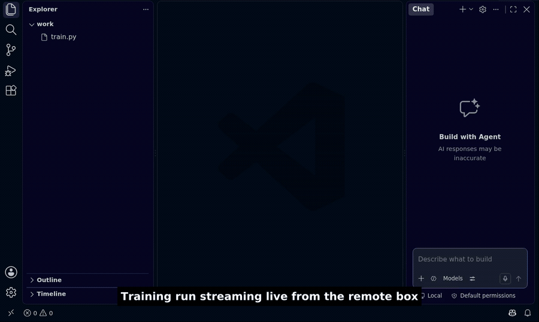
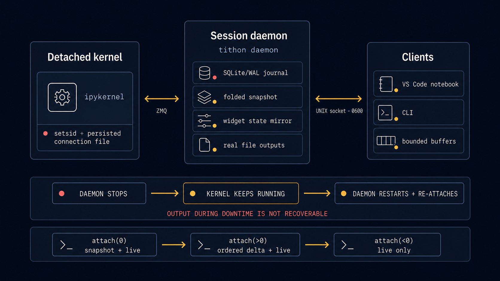

<h1 align="center">Tithon</h1>

<p align="center">
  <strong>The Python notebook built for AI agents. No JSON, no dead kernels.</strong>
</p>

<p align="center">
  <a href="https://pypi.org/project/tithon/"></a>
  <a href="https://marketplace.visualstudio.com/items?itemName=rnoro.tithon"></a>
  <a href="https://pypi.org/project/tithon/"></a>
  <a href="LICENSE"></a>
</p>



Start a long run on a remote GPU box, close your laptop, come back hours later
from another machine. The kernel is still running, and every output it printed
while you were gone is there, still streaming.

> **Status: alpha.** In daily use, with rough edges. Bug reports help a lot:
> [open an issue][issues].

## Why

| Setup                      | What happens when you disconnect                                       |
| -------------------------- | ---------------------------------------------------------------------- |
| JupyterLab                 | Kernel survives, but output printed while you were away is gone        |
| VS Code Jupyter            | Closing the window or dropping the network kills the kernel            |
| `tmux` + `jupyter console` | Survives, but no plots, HTML or widgets, and one client only           |
| **Tithon**                 | Kernel and every output survive; any client picks up where it left off |

## Built for AI agents

A `.pynb` is plain percent-format Python (`# %%` cells). Outputs live beside it
under `.tithon/`, not inside it.

| Same notebook, tokens a model reads | Tokens |
| ----------------------------------- | -----: |
| `.ipynb` with outputs               | 32,392 |
| `.ipynb` after `nbstripout`         |  1,303 |
| `.pynb`                             |    643 |

- Agents edit cells with their normal patch tool instead of rewriting JSON.
- Rerunning unchanged code leaves no Git diff, and outputs are kept, not stripped.
- Plots are real image files the model can look at, not base64 strings.
- `tithon run FILE --cells N` reruns only the edited cell in the live kernel, so
  earlier variables stay loaded.

In one debugging task (an agent fixing a failed training run, median of 6
paired runs), Tithon finished in 78.7 s against 112.5 s with Jupyter and used
1.7× fewer output tokens.

## Install

```bash
pip install tithon                       # daemon + CLI (Python 3.11+)
code --install-extension rnoro.tithon    # VS Code extension
```

Runs on Linux and macOS. On Windows, use WSL with the VS Code WSL extension.

**For AI agents**, install the [`tithon` skill](skills/tithon/SKILL.md), which
teaches an agent to edit `.pynb` cells as text, rerun single cells, and read
bounded outputs. Give your agent this prompt:

> Install Tithon for this project: `pip install tithon`, then install the agent skill
> from `https://github.com/rnoro/tithon/tree/main/skills/tithon` into your skills
> directory, read it, and follow it whenever you work on `.pynb` notebooks.

Or install it yourself:

```bash
npx skills add rnoro/tithon
```

## Quickstart

### VS Code

1. Run **Tithon: New Python Notebook…**, or open a `.pynb`.
2. Pick the **Tithon** kernel and run cells.

The extension starts the daemon for you. Reopen the notebook later, from any
window or device, and its outputs come back and keep streaming.

Over a **Tunnel** or **Remote-SSH** this works unchanged: the extension runs on
the remote host and talks to the daemon's local socket, with no port forwarding.

### CLI

```bash
tithon daemon &

tithon run -c 'x = 41'
tithon run -c 'x += 1; print(x)'     # 42

pkill -9 -f 'tithon daemon'          # kill the daemon
tithon daemon &                      # restart it

tithon run -c 'print(x)'             # 42: same kernel, state intact
```

Notebook files work the same way:

```bash
tithon run train.pynb --cells 3       # rerun cell 3 in train.pynb's kernel
tithon outputs train.pynb --summary   # one line per cell; never starts a kernel
tithon outputs train.pynb --errors    # only the cells that raised
```

## Sharing outputs through Git

The daemon writes each notebook's current outputs into your project:

```text
<project>/.tithon/
  cells/train.pynb.json   # what each cell currently shows
  outputs/                # images, deduplicated by hash
```

Commit it and anyone who clones the repository opens the notebook with your
results in place. A plot redrawn every training step still commits as one
image. Add `.tithon/` to `.gitignore` to keep outputs local.

## Coming from Jupyter

```bash
tithon import analysis.ipynb analysis.pynb
tithon export analysis.pynb analysis.ipynb
```

In VS Code: **Import Jupyter Notebook…** and **Export to Jupyter Notebook…**.

## How it works



- The kernel is standard `ipykernel`, started detached from the daemon, so the
  daemon can crash or be upgraded while the kernel keeps running.
- The daemon records kernel output on the host. A reconnecting client gets the
  current state plus whatever it missed, not a replay of every message.
- Widgets such as `tqdm` bars and sliders come back at their current value.
- The daemon listens only on a `0600` unix socket, never TCP.

Requirements are in [docs/SPEC.md](docs/SPEC.md).

## Configuration

| Variable                        | Default     | Purpose                                                        |
| ------------------------------- | ----------- | -------------------------------------------------------------- |
| `TITHON_HOME`                   | `~/.tithon` | Socket, daemon log and per-session history                     |
| `TITHON_KERNEL_IDLE_TIMEOUT`    | `0` (off)   | Seconds before an idle, unattached kernel is shut down         |
| `TITHON_HISTORY_RETENTION_DAYS` | `0` (off)   | Delete output history older than this many days                |
| `TITHON_HISTORY_TARGET_MIB`     | `0` (off)   | Soft size limit per session for output history                 |

The daemon and the extension must share `TITHON_HOME`, so run them on the same
host. Every command is documented in `tithon <command> --help`.

To lint `.pynb` files with Ruff, add `extend-include = ["*.pynb"]` to your Ruff
config.

## Contributing

Bug reports from remote and flaky-network setups are the most useful. See
[CONTRIBUTING.md](CONTRIBUTING.md).

## License

[MIT](LICENSE).

[issues]: https://github.com/rnoro/tithon/issues
