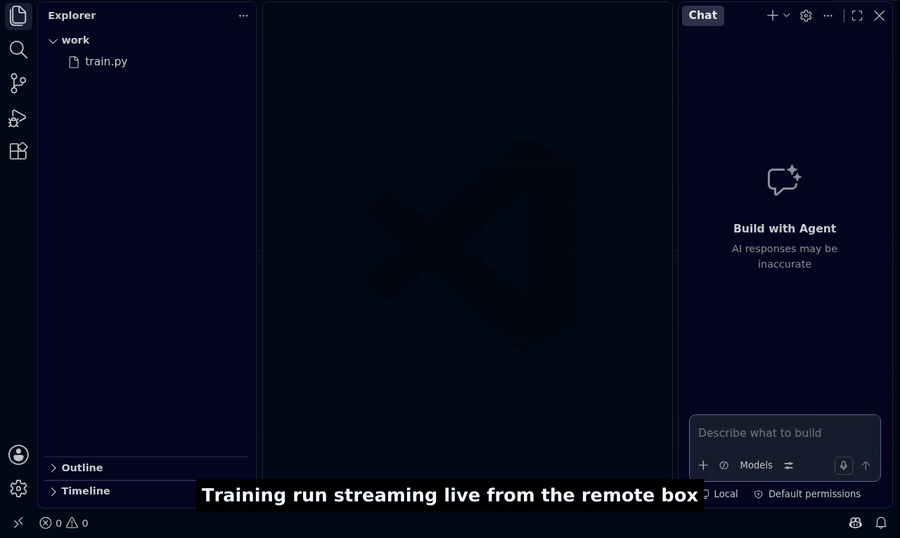
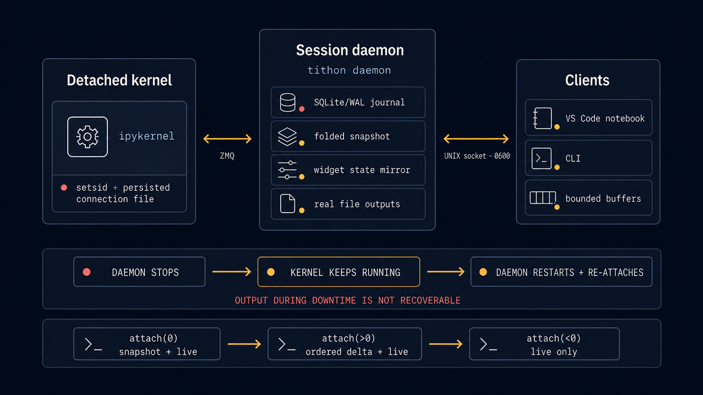

<h1 align="center">Tithon</h1>

<p align="center">
  <strong>Your Jupyter kernel dies with your client. It shouldn't.</strong>
</p>

<p align="center">
  <a href="https://pypi.org/project/tithon/"></a>
  <a href="https://marketplace.visualstudio.com/items?itemName=rnoro.tithon"></a>
  <a href="https://pypi.org/project/tithon/"></a>
  <a href="LICENSE"></a>
</p>



Keep a Jupyter kernel and its output alive independently of the client. Close your editor, lose your connection, or return later; the same session is still there and still streaming.

> **Status: alpha.** It works and it's in daily use, but you will hit rough
> edges. Bug reports are genuinely useful; please [open an issue][issues].

## The problem

You SSH into a GPU box, start a long run in a notebook, and close your laptop.
When you come back, depending on your setup:

- **JupyterLab** reconnects, but everything printed while you were away is gone.
  iopub output is streamed over the WebSocket and never persisted server-side,
  so there is nothing to replay.
- **VSCode Jupyter** ties the kernel to the extension-host process. Close the
  window or drop the network and the kernel dies, taking the session with it.
- **`tmux` + `jupyter console`** survives the disconnect, but you lose rich
  output (plots, HTML, widgets) and you can't open the same session from a
  second client.

In all three cases, the session state lives on the client or in a channel that
doesn't survive a disconnect. Tithon keeps it on the host.

## Built for AI agents

The same design that keeps your session alive also makes notebooks much easier
for coding agents to work with.

**A `.pynb` is plain Python, so it is small.** Outputs and metadata live under
`.tithon/`, not in the source file. Tokens a model reads for the same notebook:

| Format                         | Tokens |
| ------------------------------ | -----: |
| `.ipynb` with outputs          | 32,392 |
| `.ipynb` after `nbstripout`    |  1,303 |
| `.pynb`                        |    643 |

That is about **50× smaller** than the `.ipynb` with outputs, and half the size of
a stripped one. Agents also edit it differently. A `.ipynb` cell is a string array
inside JSON, so an agent has to write a script that parses, patches, and rewrites
the file. A `.pynb` cell is ordinary code that the agent's normal patch tool edits
directly.

**Clean Git history, with the outputs kept.** If you rerun unchanged code, a
`.ipynb` shows a 26-line diff and two branches conflict on merge. A `.pynb` shows
no diff and merges cleanly. `nbstripout` gets the same clean history by deleting
the outputs. Tithon keeps them on the host and optionally committed under
`.tithon/` (see [Sharing a notebook's outputs](#sharing-a-notebooks-outputs)).

**Plots are images the model can see.** Rich outputs are stored as real image
files, so an agent can give a plot to the model as an image instead of spending
thousands of tokens on base64 strings.

**Rerun only what changed, in the live kernel.** `tithon outputs --summary`
summarizes each cell on a single line, and `tithon run FILE --cells N` reruns
only the cell the agent edited while keeping earlier variables loaded in memory.
Here is a comparison from a debugging run where an agent inspected a failed
training notebook, fixed the config, and retrained:

|                      | Jupyter |  Tithon |             |
| -------------------- | ------: | ------: | ----------- |
| Time to finish       | 112.5 s |  78.7 s | 1.4× faster |
| Output tokens        |   1,865 |   1,090 | 1.7× fewer  |
| Input tokens         | 240,813 | 202,102 | 1.2× fewer  |

See [Install → For AI agents](#for-ai-agents) for the skill that teaches agents
these commands, and [For coding agents](#for-coding-agents) for the CLI details.

## Requirements

- **Python 3.11+** for the daemon and CLI.
- A Unix-like host. The daemon uses unix domain sockets and `setsid`. Linux is
  the primary development and test platform, and the CLI also runs on macOS.
- For the notebook UI, **VSCode** with the Tithon extension. If the host is
  remote, connect over a Tunnel or Remote-SSH so the notebook works the same
  way as it does locally.

> On Windows, we recommend running Tithon inside WSL and connecting with VS Code using the WSL extension.  
> Native Windows is not currently supported.

## Install

### For humans

The CLI ships on PyPI:

```bash
pip install tithon      # or: uv add tithon
```

The VSCode extension is on the Marketplace:

```bash
code --install-extension rnoro.tithon
```

or search for "tithon" in the Extensions view. ([Marketplace page][marketplace])

### For AI agents

Without guidance, models often treat a `.pynb` as notebook JSON, rerun the whole
file, or write custom kernel clients. The [`tithon` agent skill](skills/tithon/SKILL.md)
shows them how to edit cells as plain text, rerun individual cells in the
persistent kernel, read bounded outputs, inspect saved plot images, and avoid
interfering with a kernel a person is actively using.

You can give your agent this prompt to set itself up:

> Install Tithon for this project: `pip install tithon`, then install the agent skill
> from `https://github.com/rnoro/tithon/tree/main/skills/tithon` into your skills
> directory, read it, and follow it whenever you work on `.pynb` notebooks.

Or install the skill yourself:

```bash
# Claude Code (user-wide; use .claude/skills/ inside a repo for one project)
mkdir -p ~/.claude/skills/tithon
curl -fsSL https://raw.githubusercontent.com/rnoro/tithon/main/skills/tithon/SKILL.md \
  -o ~/.claude/skills/tithon/SKILL.md

# Other agents that support Agent Skills (Codex, Cursor, Gemini CLI, …)
npx skills add rnoro/tithon
```

## Quickstart

### In VS Code

1. Run **Tithon: New Python Notebook…** to create a saved `.pynb`, or open one.
2. Pick the **Tithon** kernel and run cells as usual.

The extension starts the daemon if needed, and selecting the kernel attaches
the session. Output is journaled on the host, so when you reopen the notebook
later (VSCode remembers the kernel), it is restored and resumes streaming
automatically. A `.pynb` is readable percent-format Python (`# %%` cells).

Over a VSCode **Tunnel** or **Remote-SSH** this works the same way: the extension
host runs on the remote and talks to the daemon's local socket directly, without
port forwarding.

> [!NOTE]
> The daemon and the extension must run on the **same host** (they share
> `TITHON_HOME`, default `~/.tithon`). A Tunnel/Remote-SSH satisfies this
> automatically. If you instead run the extension on your laptop against a
> _remote_ daemon, forward the unix socket yourself (SSH `RemoteForward`, `socat`, …).

### From the CLI

Daemon state (socket, log, kernel connection files, and per-session journals)
lives under `TITHON_HOME` (default `~/.tithon`), while rich-output artifacts and
shared cell snapshots live under `<workdir>/.tithon/`.

Start the daemon in the background:

```bash
tithon daemon &
tail -f ~/.tithon/daemon.log     # optional
```

Run a notebook's cells, then read their outputs without running anything:

```bash
tithon run train.pynb                 # all cells, in train.pynb's own kernel
tithon run train.pynb --cells 3       # just cell 3; earlier cells' variables stay loaded
tithon outputs train.pynb --summary   # one-line summary per cell
```

Even if the daemon process is killed, the kernel keeps running:

```bash
tithon run -c 'x = 41'
tithon run -c 'x += 1; print(x)'     # -> 42

pkill -9 -f 'tithon daemon'          # kill the daemon; the kernel stays alive
tithon daemon &                      # restart and re-attach to the same kernel

tithon attach --since 0 --once       # full snapshot: the earlier output is back
tithon run -c 'print(x)'             # -> 42, kernel state intact
```

## Sharing a notebook's outputs

A percent-format `.pynb` or `.py` holds only code, and the daemon's journal is
machine-local (binary, unbounded, unmergeable). Alongside it, the daemon writes
the _folded_ output state as text in your project:

```text
<project>/.tithon/
  cells/<relpath>.json       # what each cell currently shows (e.g. train.pynb.json)
  notebooks/<relpath>.json   # imported notebook metadata/attachments, when applicable
  outputs/                   # its images, sha256-deduplicated
```

If you commit that directory, anyone who clones the repository can open the
file with your results already populated, without storing outputs inside the
`.py` file. Images are referenced rather than embedded, so a plot redrawn every
step of a training loop still commits a single file rather than one per frame.
Leave the directory uncommitted (or `.gitignore` it) to keep outputs local; your
own session still restores from the journal either way.

Terminating a kernel yourself (`tithon kill`, or **Tithon: Terminate Kernel…**)
marks that session as finished, so reopening the file will not restore its
cells automatically. The history is still kept and can be restored via
**Tithon: Restore Previous Outputs**. Any involuntary disconnect (daemon
restart, host reboot, dropped tunnel, idle GC) restores automatically.

## Coming from Jupyter

```bash
tithon import analysis.ipynb analysis.pynb   # source to .pynb; outputs and metadata to .tithon/
tithon export analysis.pynb analysis.ipynb   # back to .ipynb, without executing code
```

In VS Code, use **Import Jupyter Notebook…** and **Export to Jupyter Notebook…**.
Existing `.py` scripts still open as text. **Open as Notebook** shows them as
cells, and **Copy as Python Notebook…** makes a separate `.pynb` (live variables
do not carry over to the copy). The exact copy rules are in
[docs/reference.md](docs/reference.md#vs-code-opening-copying-importing-and-exporting-files).

## How it works

A long-lived **daemon** on the host owns the kernel and serves clients:



- The kernel runs **detached** (`setsid`), so it is not a child of the daemon.
  The daemon can crash, restart, or be upgraded while the kernel keeps running
  and re-attaches through a persisted connection file.
- Every execution iopub message (plus daemon lifecycle and widget comm events) is
  journaled to append-only SQLite (WAL) by default, alongside a per-execution
  _folded_ snapshot of the current display state for fast reconnects.
- Clients attach with the last sequence number they saw and receive a snapshot
  plus an ordered, gapless delta stream.
- Rich outputs (images) are stored as files and referenced by hash rather than
  base64-embedded. `ipywidgets` traffic is folded into a `widget-state+json`
  snapshot, so a `tqdm` bar or a slider comes back at its current value.
- Backpressure is bounded: per-subscriber buffers are capped, and a client that
  falls too far behind is dropped and resyncs on reconnect, preventing a slow
  client from growing daemon memory or blocking others.
- The daemon binds a `0600` unix domain socket with no TCP listener.

The kernel itself is standard `ipykernel`; Tithon only manages the session layer
around it. See [`docs/SPEC.md`](docs/SPEC.md) for the full design.

## CLI reference

| Command                     | Description                                                                                                                                         |
| --------------------------- | --------------------------------------------------------------------------------------------------------------------------------------------------- |
| `tithon daemon`             | Run the daemon (foreground). Supports `--log-level`, `--idle-timeout`, `--history-retention-days`, and `--history-target-mib`.                      |
| `tithon run -c CODE`        | Submit code and stream its output (`--session <uri>`, `--no-wait` to print the exec id and exit, `--timeout N` to bound the wait).                  |
| `tithon run FILE`           | Run a notebook file's cells (`--cells 1,3-4`, default all) in its persistent kernel and print their bounded outputs; exit 1 if a cell raised.      |
| `tithon outputs FILE`       | Print a notebook file's current outputs, bounded for agents (`--cells`, `--errors`, `--summary`, `--tail/--head N`, `--grep RE`, `--json`).        |
| `tithon import SRC DEST`    | Import a Python nbformat 4 `.ipynb` as percent source (`.pynb` or `.py`) plus saved outputs and metadata (`--workdir PROJECT`).                     |
| `tithon copy SRC DEST`      | Copy percent source, current outputs, and metadata into an independent file session within one project (`--workdir PROJECT`).                       |
| `tithon export SRC DEST`    | Export saved source plus current/saved outputs as a Python nbformat 4 `.ipynb` without executing code (`--workdir PROJECT`).                        |
| `tithon attach`             | Stream events as NDJSON (`--session <uri>`, `--since N` resume point, `--once` exit after backlog sync, `--until-done` exit after next completion). |
| `tithon status`             | Print daemon, session, queue, kernel, widget-model, and storage status (all sessions, or one with `--session <uri>`).                               |
| `tithon restart`            | Restart a session's kernel with a fresh namespace (`--session <uri>`, default `default`).                                                           |
| `tithon interrupt`          | Send SIGINT to the running cell of a session (`--session <uri>`, default `default`).                                                                |
| `tithon kill`               | Terminate one session's kernel (`--session <uri>`) or all running kernels (`--all`); journals are kept.                                             |
| `tithon shutdown`           | Stop the daemon; kernels stay detached unless `--kill-kernels` is passed.                                                                           |
| `tithon version`            | Print the installed `tithon` package version.                                                                                                       |

`attach --since` controls how history is replayed on reconnect:

- `--since 0`: full folded snapshot, then live delta.
- `--since N`: replay only events after seq `N`, then a `sync` marker, then live.
- `--since -1`: live only, ignore history.

### For coding agents

`tithon run` and `tithon outputs` let an agent run specific cells and inspect
bounded outputs from the same persistent kernel open in VSCode:

```sh
tithon run exp/train.pynb --cells 2-4      # rerun only what changed, print bounded outputs
tithon outputs exp/train.pynb --summary    # status, time, and last line per cell
tithon outputs exp/train.pynb --errors     # just the cells that raised, traceback tail
tithon outputs exp/train.pynb --cells 2 --grep "val_loss"
```

Cells are numbered as in the file (markdown cells count), and each header shows
the cell's line span for editing. Each text output keeps its last 5 lines by
default (20 for tracebacks) and notes how many lines were omitted. Images are
listed as file paths under `.tithon/outputs/`, and widgets as text of their
final state. `outputs` never starts a daemon or a kernel: it reads from the
running daemon (including cells still running) or from the saved output file. An
edited cell shows no output until it runs again, so an agent does not read stale
results from older code.

Multiple edit-and-run steps can also be chained in a single shell command (see
`tithon run --help`) to save tool calls during iterative debugging.

## Configuration

The settings you are most likely to change, read by the daemon and CLI:

| Variable                        | Default     | Purpose                                                                                  |
| ------------------------------- | ----------- | ---------------------------------------------------------------------------------------- |
| `TITHON_HOME`                   | `~/.tithon` | Root for the socket, daemon log, kernel connection files, and per-session journals.      |
| `TITHON_KERNEL_IDLE_TIMEOUT`    | `0`         | Seconds of inactivity before an unattached idle kernel is reaped (`0` = disabled).       |
| `TITHON_HISTORY_RETENTION_DAYS` | `0`         | Opt-in age limit (days) for raw output-message compaction (`0` = disabled).              |
| `TITHON_HISTORY_TARGET_MIB`     | `0`         | Opt-in soft size target (MiB) per session for raw output-message compaction (`0` = off). |

The backpressure and polling knobs are listed in
[docs/reference.md](docs/reference.md#environment-variables).

### Python language services

Notebook cells use the Python language, so Pylance, ty and Ruff work inside them.
Ruff's default file selection excludes `.pynb`; add this to your project's
`ruff.toml` (or the equivalent `tool.ruff` setting in `pyproject.toml`):

```toml
extend-include = ["*.pynb"]
```

Some language-server features are not yet at parity with plain `.py` files. See
[docs/known_issue.md](docs/known_issue.md) and the
[verification status](docs/reference.md#python-language-services-verification-status).

## Contributing

Bug reports are especially welcome, particularly for disconnect scenarios on
remote setups. See [CONTRIBUTING.md](CONTRIBUTING.md) for what makes a report
actionable, how to set up a development environment, and how to propose a
change to the design.

## License

[MIT](LICENSE).

[issues]: https://github.com/rnoro/tithon/issues
[marketplace]: https://marketplace.visualstudio.com/items?itemName=rnoro.tithon
