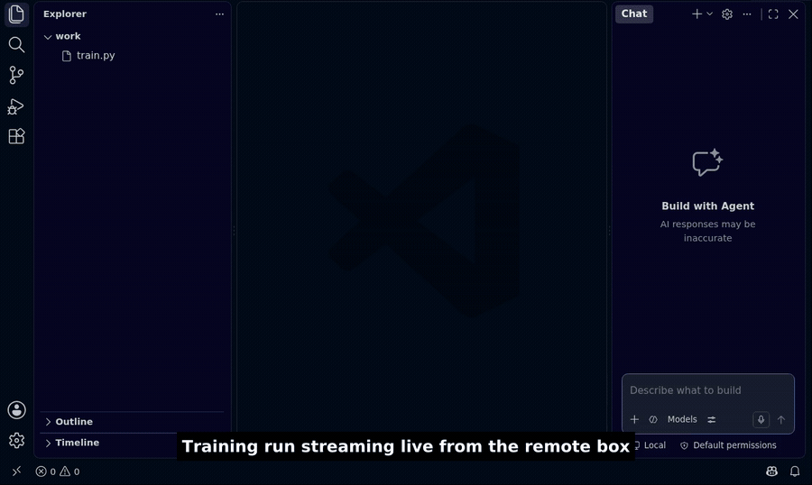
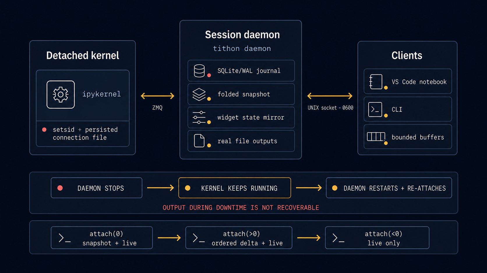

<h1 align="center">Tithon for VS Code</h1>

<p align="center">
  <strong>The Python notebook built for AI agents. No JSON, no dead kernels.</strong>
</p>

<p align="center">
  <a href="https://marketplace.visualstudio.com/items?itemName=rnoro.tithon"></a>
  <a href="https://pypi.org/project/tithon/"></a>
  <a href="https://github.com/rnoro/tithon"></a>
</p>



Start a long run on a remote GPU box, close your laptop, come back hours later
from another machine. The kernel is still running, and every output it printed
while you were gone is there, still streaming.

The kernel lives in a daemon on the host, not in the editor, so closing VS Code
only stops the rendering, never the work.

> **Status: alpha.** In daily use, with rough edges. Bug reports help a lot:
> [open an issue][issues].

## Why

| Setup                      | What happens when you disconnect                                       |
| -------------------------- | ---------------------------------------------------------------------- |
| VS Code Jupyter            | Closing the window or dropping the network kills the kernel            |
| JupyterLab                 | Kernel survives, but output printed while you were away is gone        |
| `tmux` + `jupyter console` | Survives, but no plots, HTML or widgets, and one client only           |
| **Tithon**                 | Kernel and every output survive; any client picks up where it left off |

## Install

```bash
code --install-extension rnoro.tithon
pip install tithon        # the daemon, on the host (Python 3.11+)
```

Runs on Linux and macOS hosts. On Windows, use WSL with the VS Code WSL extension.

## Quickstart

1. Run **Tithon: New Python Notebook…**, or open a `.pynb`.
2. Pick the **Tithon** kernel and run cells.

The extension starts the daemon for you. Reopen the notebook later, from any
window or device, and its outputs come back and keep streaming. There is no
command to run.

Over a **Tunnel** or **Remote-SSH** this works unchanged: the extension runs on
the remote host and talks to the daemon's local socket, with no port forwarding.

## What you get

- **Plain Python on disk.** A `.pynb` is percent-format Python (`# %%` cells).
  Outputs live under `.tithon/`, so diffs stay clean and AI agents edit cells as
  ordinary code.
- **Outputs that follow their cells** through inserts, moves and edits.
- **Live widgets.** `tqdm`, standard ipywidgets and anywidget render and come
  back at their current value after a reconnect.
- **Outputs in Git.** Commit `.tithon/` and anyone who clones the repository
  opens the notebook with your results in place.
- **Language servers inside cells.** Pylance, ty and Ruff work in the notebook.
  For Ruff, add `extend-include = ["*.pynb"]` to your Ruff config.
- **Jupyter interchange.** **Import Jupyter Notebook…** and
  **Export to Jupyter Notebook…**, without executing code.

Existing `.py` scripts open as text. **Open as Notebook** shows one as cells,
and **Tithon: Always Open With…** remembers the choice per file.

## Useful commands and settings

| Command                             | What it does                                           |
| ----------------------------------- | ------------------------------------------------------ |
| `Tithon: Terminate Kernel…`         | Free a kernel and its GPU memory                       |
| `Tithon: Restore Previous Outputs`  | Bring back a terminated session's outputs              |
| `Tithon: Select Python Interpreter` | Choose the Python the kernel runs on                   |
| `Tithon: Show Session Storage`      | See where history is stored and how much space it uses |

| Setting                    | Default | Purpose                                                          |
| -------------------------- | ------- | ---------------------------------------------------------------- |
| `tithon.pythonPath`        | `""`    | Python for the daemon; empty uses the selected interpreter       |
| `tithon.kernelIdleTimeout` | `0`     | Shut down idle, unattached kernels after N seconds (`0` = never) |
| `tithon.homePath`          | `""`    | Where the daemon keeps its socket and history                    |

The full lists are in the **Feature Contributions** tab.

## How it works



- The kernel is standard `ipykernel`, started detached from the daemon, so the
  daemon can crash or be upgraded while the kernel keeps running.
- The daemon records kernel output on the host. A reconnecting client gets the
  current state plus whatever it missed, not a replay of every message.
- The daemon listens only on a `0600` unix socket, never TCP.

The extension and the daemon must run on the same host. The daemon also ships a
CLI for terminals and AI agents; see the [project README][repo].

## License

[MIT](https://github.com/rnoro/tithon/blob/main/LICENSE).

[repo]: https://github.com/rnoro/tithon
[issues]: https://github.com/rnoro/tithon/issues
